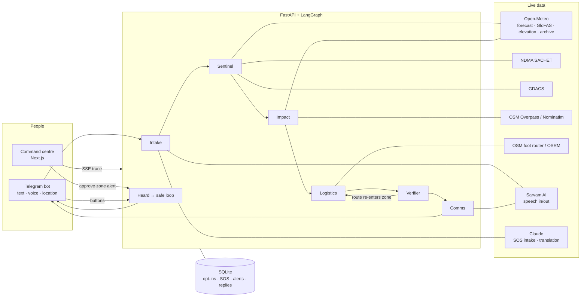

# RAHAT राहत

**From alert to "I'm safe".** RAHAT turns live flood, heat and cyclone data into a plan for one person: where to go, which road is safe, in their own language, by voice. Then it checks that people in the danger zone actually heard the alert, and sends help to those who didn't make it out.

Built for the **Forge Gen AI Buildathon** · Theme 2: Climate, Resource Infrastructure & Global Supply Resilience · *Autonomous Emergency Response & Logistics Swarm* · Team Clauder

---

## The problem

India doesn't lack forecasts. It lacks the last mile. Official warnings (IMD, NDMA SACHET) cover whole districts, are mostly text, and are fire-and-forget: nobody knows who heard them. In Nepal's September 2024 floods, over 4 million alert SMS went out and 250 people still died. Relief coordination still runs on phone calls and WhatsApp groups.

## What RAHAT does

| For | What they get |
|---|---|
| **Citizens** (Telegram, any language, voice or text) | Send an SOS, a voice note or a location. Get back the hazard level with its source, the nearest safe shelter on higher ground, a walking route that avoids the danger zone, a map pin and a spoken alert. |
| **Officials** (web command centre) | A live map of India with rain radar, official alert areas and cyclone tracks; a watchlist ranked by IMD colour level; the agent's reasoning streamed step by step; one-tap approval to alert everyone in a zone; and a live **heard → safe** count. |
| **People in a zone after an alert** | Buttons: ✅ Got it · 🟢 I'm safe · 🔴 Need help. Silence triggers re-sends; "need help" immediately runs a new rescue plan. |

## Architecture



### The agent pipeline

| Step | What it does | Self-correction |
|---|---|---|
| **Intake** | Reads the SOS in any language (Claude, structured output), extracts the need and the place; geocodes a spoken place name | Falls back to script detection and keyword rules without an LLM; asks for location when it can't find one; refuses points outside India |
| **Sentinel** | Scores the hazard with fixed rules: IMD rainfall thresholds, IMD heatwave criteria against the 1991-2020 normal, GloFAS river discharge vs. seasonal median, plus official SACHET and GDACS alerts | Missing forecast data makes the level **unknown**, never safe; an official alert can only raise a level |
| **Impact** | Finds hospitals, schools and colleges; flags those inside the hazard zone; gets elevations | Races two Overpass mirrors, falls back to Nominatim |
| **Logistics** | Picks the nearest school outside the zone on higher ground; routes on foot | Falls back from the foot router to OSRM driving, then to direction-only with a warning |
| **Verifier** | Checks the route geometry leaves the zone and never re-enters; checks every number in the alert comes from a tool | Rejects the shelter and loops back to Logistics (max 2 retries), then flags for a human |
| **Comms** | Fills the alert from verified values only, in Hindi and English; Claude translates to other languages | A translation is rejected if any number changes |

**The LLM never sets a hazard level, picks a shelter or draws a route.** Those come from deterministic code with cited sources, which is how RAHAT avoids hallucinated safety advice.

### Live data sources (no mock data)

Open-Meteo forecast, flood (GloFAS), elevation and historical archive · NDMA SACHET CAP alerts · GDACS · OpenStreetMap via Overpass and Nominatim · OSM foot router (routing.openstreetmap.de) and OSRM · RainViewer radar · Esri World Imagery · Sarvam AI speech · Claude. People, SOS requests and alert replies are stored only when real users act.

## Repository

```
apps/web/          Next.js command centre (MapLibre, Motion)
services/api/      FastAPI + LangGraph backend and Telegram bot
  rahat/graph/     agent nodes and graph
  rahat/sources/   one module per live data source
  rahat/hazards.py deterministic hazard rules
  rahat/bot.py     Telegram channel and heard → safe loop
  tests/           hazard rule and store tests
design/            original design prototype
```

## Run it locally

Requirements: Python 3.12, Node 20+.

**API**

```bash
cd services/api
python -m venv .venv
.venv/Scripts/pip install -r requirements.txt   # macOS/Linux: .venv/bin/pip
cp .env.example .env                             # add keys (all optional)
.venv/Scripts/python -m uvicorn main:app --host 127.0.0.1 --port 8787
```

**Web**

```bash
cd apps/web
npm install
echo NEXT_PUBLIC_API_URL=http://127.0.0.1:8787 > .env.local
npm run dev
```

Open http://localhost:3000.

**Keys** (in `services/api/.env`; the app runs without any of them, with fallbacks):

| Variable | Turns on |
|---|---|
| `TELEGRAM_BOT_TOKEN` | the Telegram bot (create one with @BotFather) |
| `SARVAM_API_KEY` | voice notes in, spoken alerts out |
| `ANTHROPIC_API_KEY` | free-text SOS understanding and alert translation |

**Tests**

```bash
cd services/api && .venv/Scripts/python -m pytest -q
```

## Deploy

- **API:** `services/api/Dockerfile` (runs as a non-root user on port 8000). Run exactly **one** always-on instance, because the bot uses long polling. Our live instance runs on Hugging Face Spaces (Docker); any container host works. Mount a persistent volume at `/data` to keep the SQLite database across restarts. Set the keys above plus `RAHAT_CORS_ORIGINS=https://<your-web-domain>`.
- **Web:** deploy `apps/web` as its own project (we use Vercel) with `NEXT_PUBLIC_API_URL=https://<your-api-domain>`. Serverless platforms can't host the API: the bot and the re-send loop need a process that stays running.

## Credits

Map imagery and labels © Esri, Maxar, Earthstar Geographics · Radar © RainViewer · Map data © OpenStreetMap contributors (ODbL) · Weather and flood data © Open-Meteo (CC BY 4.0), GloFAS / Copernicus · Alerts © NDMA SACHET, GDACS. RAHAT supports, and never replaces, official instructions. In an emergency, call **112**.
